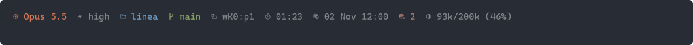
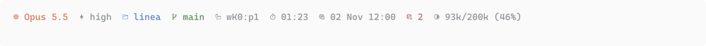
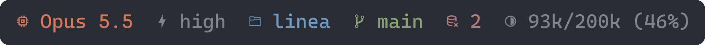

# linea

A status line for Claude Code: model, effort, project, branch, herdr pane, session time, prompt cache and context use, fitted to the terminal width.




On a narrow terminal the lower-ranked sections give way and the branch is cut short:



The icons come from [Nerd Fonts](https://www.nerdfonts.com) v3.

## Install

```sh
mise use -g github:srnnkls/linea
```

Then point Claude Code at it in `settings.json`:

```json
"statusLine": { "type": "command", "command": "linea" }
```

## Configuration

linea starts from its [built-in defaults](assets/config/default.toml) (`linea defaults` prints them) and merges these files over them, later ones winning:

1. `~/.config/linea/linea.toml`, or the file `LINEA_CONFIG` names
2. `linea.toml`, then `linea.local.toml`, in every directory from `/` down to the session's working directory

Tables merge key by key; any other value, arrays included, replaces the one beneath it. A broken configuration shows its error in place of the line.

```toml
[line]
sections = ["model", "effort", "project", "branch", "weather", "context"]
separator = "  "

[appearance]
mode = "auto"            # auto follows macOS; dark or light pins a palette

[palette.dark]
teal = "#4db5bd"

[sections.effort]
enabled = false

[sections.branch]
colour = "teal"
fit = { rank = 3, grow = true, min = 16, requires = "project" }

[sections.cache]
format = "%H:%M"
```

A colour name has to exist in both palettes.

### Sections

The built-in sections are `model`, `effort`, `project`, `branch`, `pane`, `duration`, `cache`, `misses` and `context`. Each takes:

| Key | Meaning |
| --- | --- |
| `icon` | Drawn before the text; empty draws the text alone |
| `icons` | Steps from empty to full, picked by the context share |
| `colour` | A palette name or a literal `#rrggbb` |
| `fit` | `"always"`, a rank, or `{ rank, grow, min, requires }` |
| `enabled` | `false` leaves the section out |
| `format` | strftime format for `cache` |

Sections that `fit = "always"` take their columns first. Ranked sections then claim theirs from the lowest rank up while they fit. One section may `grow`: it holds up to `min` columns at its rank and takes whatever is left once every rank is placed, cut short with an ellipsis. `requires` draws a section only when another one is drawn.

### Hooks

A section with `run` is a hook: a shell command whose first line of output is the section's text.

```toml
[sections.weather]
run = "curl -s 'wttr.in/?format=%t'"
icon = "󰖐"
colour = "grey"
fit = 6
refresh = "10m"
timeout = "3s"
```

The command runs through `sh -c` in the session's working directory, with Claude Code's status JSON on stdin and `LINEA_SECTION` set to the section's name. The line never waits on it: linea shows the output it last cached for the session and starts a detached refresh once that output is older than `refresh` (30 seconds unless set). A command that fails, or outlasts `timeout` (5 seconds unless set), hides the section until its next refresh. Output is cached under `$XDG_CACHE_HOME/linea/hooks`.

### Integrations

```toml
# The pane section shows only inside a running herdr.
[herdr]
enabled = true
inside = "HERDR_ENV"
pane = "HERDR_PANE_ID"
socket = "HERDR_SOCKET_PATH"

# Model and effort changes go to this command as a StatusLine hook event on stdin.
[report]
enabled = true
command = ["limen", "hook", "claude"]
received = '"received":true'
retry = "30s"
requires = "HERDR_PANE_ID"

# Where the effort level comes from when the session reports none.
[claude]
effort = "CLAUDE_CODE_EFFORT_LEVEL"
settings = "~/.claude/settings.json"   # unset follows CLAUDE_CONFIG_DIR
```

## Development

```sh
mise run check     # clippy, rustfmt, tests
mise run preview   # re-render docs/preview; LINEA_PREVIEW_FONT and LINEA_PREVIEW_FAMILY pick the font
```
